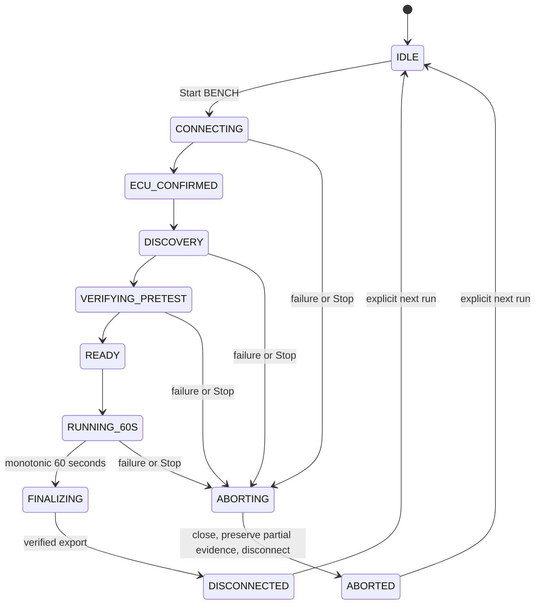

# v0.2.10 one-click Benchmark

**Benchmark** is a permanent left sidebar entry, including a text label in compact mode. It runs only after **Start BENCH**. Choose Simulation or LIVE and the outgoing port in Connection settings, then select **1, 2, 3 or 4 requests/second** (default 2). The duration is fixed at **60 seconds of measurement after preflight**. The click acknowledges parked conditions, brake applied, safe transmission, adequate ventilation and no competing OBD client. Never run in a closed garage. A zero speed reading does not establish parking-brake engagement.

One click connects or reuses a suitable idle connection, refreshes recorded same-ECU bitmaps, prepares the existing CAN format, checks current MAP/MAF range selectors and strictly positive RPM/MAP/MAF/speed, starts the measurement, closes its original journal, verifies the private ZIP/report and disconnects. Preparation is bounded to 30 seconds and is recorded as PREFLIGHT. It does not consume the 60-second measurement timer. There is no manual Discovery, Monitor, Recording, PID selection, hidden checkbox or second dialog in this workflow.

## Wire and time contract

The repeated fixed set is **010D speed → 010C RPM → 010B MAP → 0110 MAF**, identical at every selectable rate. A positive same-ECU speed of zero is required before measurement and once per four measurement sends. Unknown, invalid or moving speed aborts. The speed requests consume the same aggregate budget. Each signal nominally receives one quarter of the requested rate: approximately 0.25/0.50/0.75/1 Hz at 1/2/3/4 total req/s; actual acquisition can be slower.

The existing serialized worker and hard transport limiter own all initialization, Discovery, preflight and measurement requests, including across connections. Minimum wire spacing remains 250 ms, or longer at a lower selected rate. A monotonic operation deadline is checked again immediately before sending; an early Windows wait cannot authorize a send outside the measurement window. The cap is **240 actual measurement sends**, with the full 60-second timer retained even if that cap is reached. There is no old 48-send early stop, no adaptive rate change inside a benchmark, no automatic next run and no rate above four through any new entry point.

NRC, transport/framing failures, NO DATA, invalid required layouts, ECU mismatch, moving/unknown speed or response latency above 1000 ms abort conservatively. Their categories and reasons remain distinct. Decoder mismatch, cancellation and NO DATA are not claims of ECU overload. No reconnect is automatic. A running session, manual recording/polling or replay is rejected without being stopped or hijacked. Multiple ECU responders require explicit resolution outside the benchmark; none is selected arbitrarily.

The final portion of the measurement window reserves the same one-second receive allowance at every rate. Requests that cannot complete with that allowance are not started; the full 60-second countdown still completes. This avoids treating window closure as an ECU/transport failure and can reduce the best-case send count slightly.

## Results and recovery

The timer, progress and actual sent count come from acknowledged worker state. Actual sustained measurement rate uses the 60-second elapsed denominator, separately from first-to-last-send performance rates. Results include original journal SHA-256, run/source/context/ECU, phase, request mix, measured/wall duration, per-PID counts, latency percentiles, gaps/jitter, wire violations and separate error/stop reasons. A CAN address is not proof of exact ECU/calibration identity. Coolant is outside this fixed subset, so thermal equivalence between runs is UNKNOWN.

After completion or abort, **Open report** opens the private HTML; **Open folder** opens the bundle directory. Names are unique:

- Original journal: `<run-id>.jsonl` in the configured local data directory.
- Verified export: `bundles/<run-id>-research-<unique-suffix>.zip`.
- Companion report: the ZIP basename with `.html` and `.json`.

The UI keeps the exact paths for the latest acknowledged run. Existing exports are never overwritten. An export failure preserves the journal and exposes **Retry export offline**; no new ECU requests are sent. Interrupted journals can be recovered without modifying their original bytes.

Use **Sessions → Offline ECU inventory / OBD performance…** to select consecutive private bundles. Completed benchmarks remain separate, with side-by-side rate/mix/source/outcome facts and explicit thermal/identity limitations. A suggested next choice is optional and bounded to 1..4; it never launches itself. Passive drive measurements are not a controlled benchmark comparison.

## Normal sessions and research limits

Normal operation stays **Connect → Start Session → Finish Session**. The default **Comprehensive** choice includes every eligible standard/RAW PID in the existing fixed scope. Optional **DPF + Turbo / Critical subset** explicitly selects only documented DPF/turbo context PIDs and retains bounded weights/fairness. Its omissions are recorded. Select it while parked; no mid-drive interaction is required. More temporal detail costs broad sensor coverage; even this profile does not establish sub-second turbo response or causal lag.

The command allowlist is unchanged from v0.2.9. No new OEM/UDS identifier is enabled. `018C` accepts only its reviewed 17-byte historical numeric definition; any 15-byte alternative stays **SUPPORTED / RAW LAYOUT UNVERIFIED**, retained offline without padding or truncation. `0101` full ignition-specific readiness and `019D` applicable later definition remain blocked. Six-byte `017A` remains RAW-only, with no pressure, DPF health, regeneration, soot or ash formula. See [research review](../research/v0.2.10-evidence-review.md).

Physical v0.2.10 vehicle validation is pending. Start the next parked field benchmark at **2 req/s**, inspect its private report, then explicitly decide whether another run within 1..4 is justified. Use an ordinary Comprehensive session separately for broad sensor/RAW evidence. Every real bundle/report remains private.
