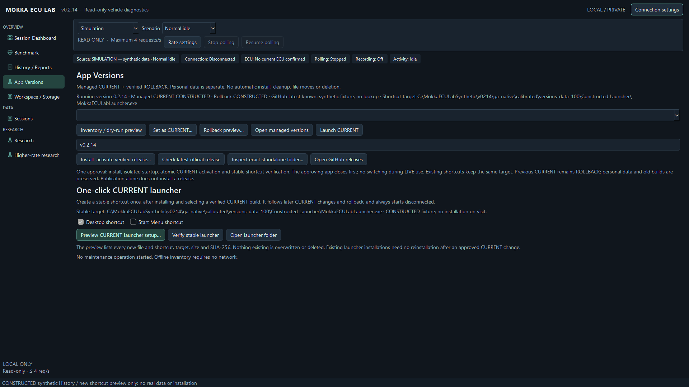
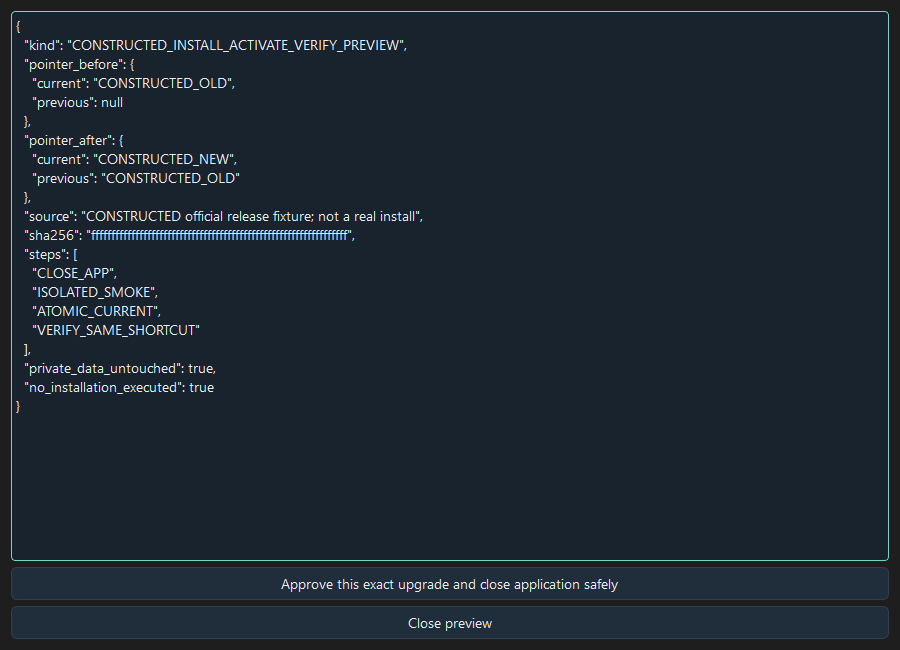
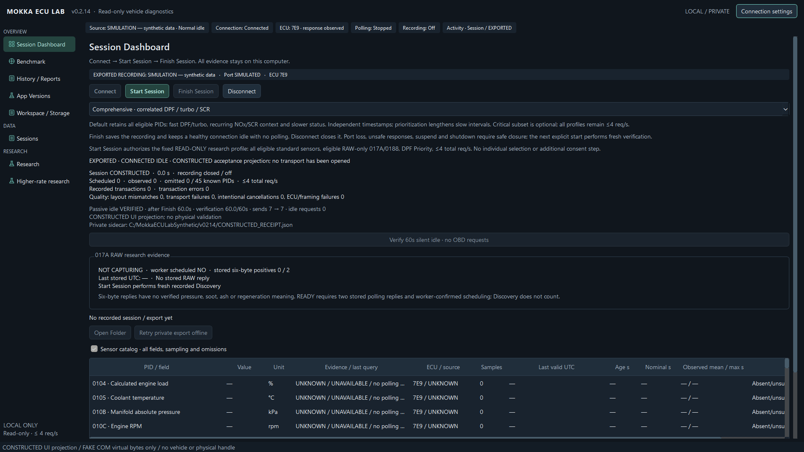

# v0.2.14 operation and approved upgrades

Publishing a release, copying a portable build and activating the owner's Desktop
installation are separate milestones. A GitHub release alone never changes a
local shortcut or CURRENT pointer. The application always starts disconnected.

## Install, activate and verify with one approval

1. Finish recording, complete the private export and Disconnect. Close other
   Mokka windows. Choose **App Versions**. The page identifies the running
   version, managed CURRENT, rollback, stable shortcut target and latest GitHub
   version known from an explicit lookup. An older running app is labelled.
2. **Check latest official release** fetches metadata only. Download the official
   Windows ZIP explicitly; there is no background download or automatic update.
3. Choose **Install & activate verified release**, select that ZIP and review
   its exact official digest, destination, file inventory, existing shortcut
   resolutions/hashes, CURRENT before/after and retained rollback.
4. Approve the single transaction. The approving app closes safely. A separate
   packaged helper waits for closure, checks official metadata again, copies
   into a new managed build, validates disconnected startup and commits CURRENT
   atomically. It then verifies the stable dispatcher. No extra Set CURRENT step
   is needed. The existing Desktop and Start Menu links keep their bytes/target.
5. The explicit UI upgrade reports success or failure in a result dialog. Close
   that message and open the same **Mokka ECU Lab** Desktop shortcut. Confirm the new window's
   version and disconnected state. A helper's verify-only success is distinct
   from observing this actual Desktop launch.

A same-version repeat verifies the existing installation without changing its
rollback. Installing an older version cannot replace newer CURRENT through the
upgrade action; use the explicit verified rollback preview. Rollback also closes
the approving application before the helper changes pointers. Old builds and
personal data are retained.

The flow checks running processes before copy and activation. Windows holds an
exclusive read handle on the old CURRENT executable during the critical switch,
preventing a simultaneous old Desktop launch. A busy/locked executable, changed
archive, shortcut, pointer, unavailable official metadata or permission failure
blocks activation. Failure after activation restores the previous exact pointer
when safe. A newly opened GUI or concurrent pointer change requires explicit
recovery after closure rather than another unsafe switch. An interrupted
operation lock is preserved for review; it is not silently removed.

## Shortcut conflicts and fresh installations

Windows resolves the actual redirected Desktop/Start Menu folders, including
OneDrive and Unicode paths. Existing links must resolve to the verified stable
dispatcher with the expected working directory and no extra arguments. Personal,
legacy direct-EXE, changed or missing shortcuts produce a specific blocking
explanation. They are preserved; an upgrade never silently replaces them.
Review the identified conflict separately before retrying. A fresh installation
with empty destinations includes explicit creation of its verified dispatcher and
shortcuts in the approval. No duplicate per-version Desktop links are generated.

On a failed fresh setup, only the transaction's newly created, hash-unchanged
shortcuts may be removed as specified in its preview. Original user files and
all old builds remain intact; partial new launcher files are retained for explicit
recovery. No live update runs while acquisition or recording is active. External
COM ownership is not probed; the updater sends no diagnostic request.

## Finish and optional silent-idle verification

Use **Connect → Start Session → Finish Session** normally. Successful Finish
closes the recording, verifies the private export and retains only a healthy,
prompt-synchronized handle as **EXPORTED · CONNECTED IDLE**. Future acquisition
starts only from a new explicit Session/Benchmark action, with fresh ECU,
protocol, bitmap, positive-response and configuration evidence. The same global
send clock remains in force.

After Finish, **Verify 60s silent idle** explicitly observes the existing local
handle and admitted-send ledger for sixty monotonic seconds. It sends no OBD
query, keepalive, reset or discovery command. The page shows elapsed time and
before/current counters. It writes a separate private receipt under
`PostExportEvidence/<session>/`, linked by session and original-bundle SHA-256;
the closed journal, ZIP and report are not modified. Disconnect, new acquisition,
lost/changed handle, clock discontinuity, suspension or an unexpected send
interrupts verification. Completed proof describes the saved interval only.

An OS-open handle and the previously synchronized prompt do not prove remote ECU
liveness or physical calibration. A completed export or FINALIZING snapshot is
not post-Finish Bluetooth retention evidence. Source mode, synthetic testing,
actual owner-machine observations and real vehicle results remain distinct.

## Engine/ignition changes and partial captures

Three consecutive ECU failures stop ordinary polling within the existing error
threshold. Conditions Not Correct remains an ECU negative response, with its
original bytes and error category intact. Recent positive RPM plus repeated
same-ECU/context conditions-not-correct replies can produce a **possible
engine/ignition off; user confirm** hint, not a diagnosis or saturation claim.
No additional ignition probe, retry loop or adapter reset is sent.

**CAPTURE ABORTED**, **EXPORT VERIFIED** and connection state are separate. Finish
can save a failed capture successfully without changing its failure classification
in History. Checksum-valid partial evidence remains useful offline. Port loss,
unsafe prompt/receive, Stop, suspend and shutdown close or isolate unsafe handles.

## Next physical acceptance

Start the approved installed build from the actual Desktop shortcut twice and
confirm its title/version and disconnected state. For a separately chosen normal
vehicle trial, use the existing adapter procedure and **Connect → Start Session**,
wait for worker-confirmed stored RAW readiness, then Finish while safely stopped
with the engine still running. Request the sixty-second passive check, retain its
private receipt, start another explicit Session/Benchmark to verify fresh evidence,
and finally Disconnect before switching ignition off. An intentional engine-off
case requires a separate stationary operator-controlled trial; never infer its
cause merely from old NRCs. A driver must not operate the computer while moving.

Normal read-only acquisition keeps one serialized worker and **4 aggregate
req/s**. The existing three sampling profiles remain available, with explicit
coverage/cadence tradeoffs and independent sample ages. No new decoder or command
is enabled. **5 req/s is fake COM only / physical LOCKED; 6 is not authorized.**
See the [source register](../research/V0214_SOURCE_REGISTER.md) and
[physical-backend readiness review](V0214_PHYSICAL_BENCHMARK_READINESS.md).

## Synthetic UI examples

These are constructed Qt projections. They prove neither owner installation nor physical ECU/idle results.

